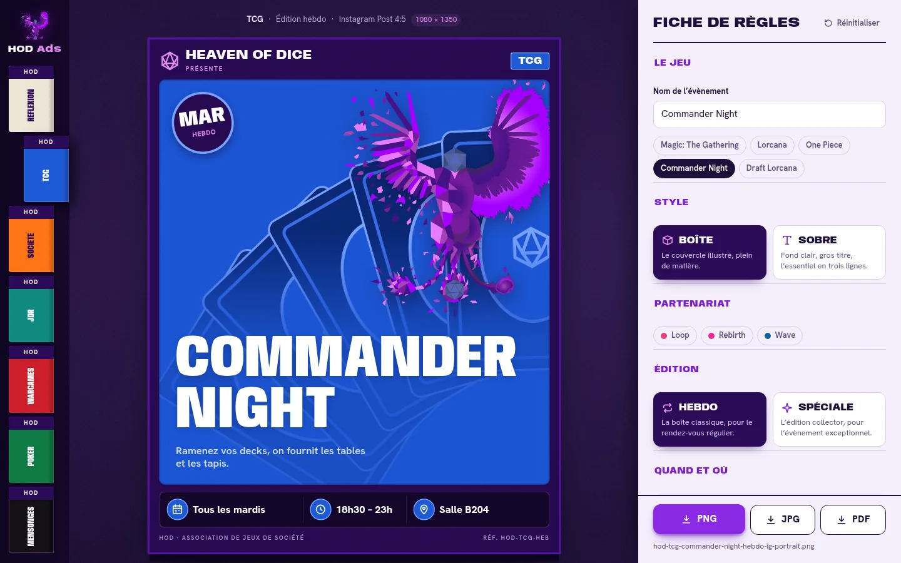
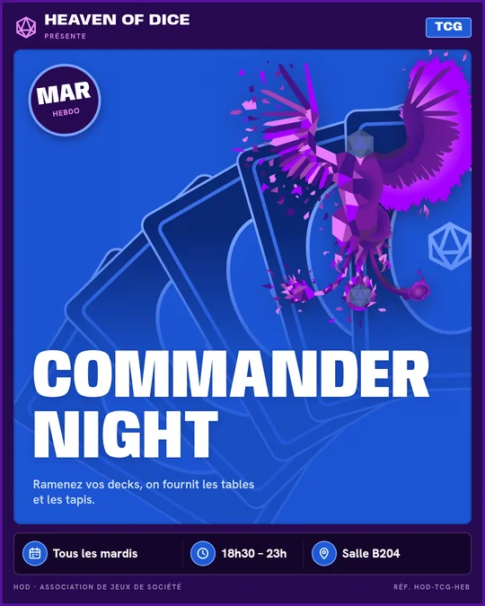
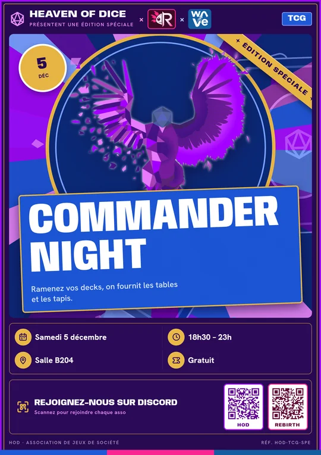
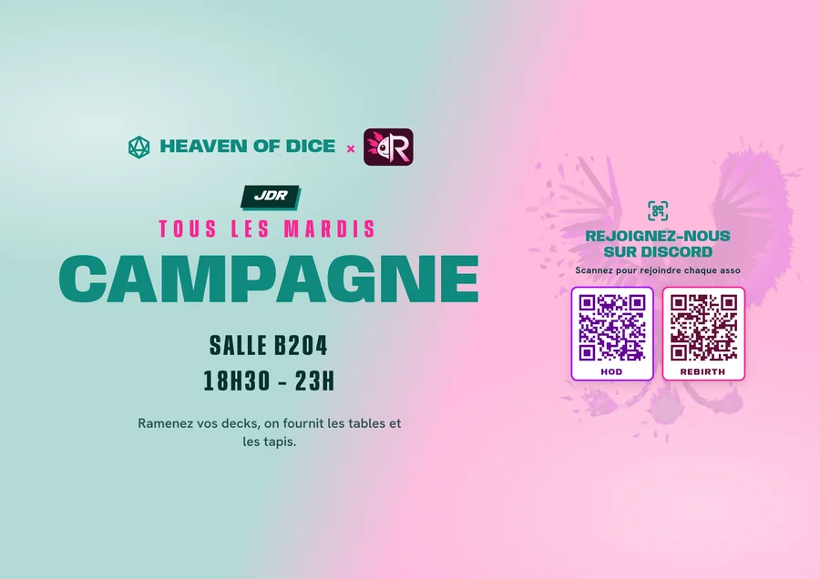

# HOD Ads

[](https://vite.dev)
[](https://react.dev)
[](https://www.typescriptlang.org)
[](https://hod-ads.vercel.app)

Générateur d'affiches pour les évènements de l'association Heaven of Dice.

> [!TIP]
> En ligne : **https://hod-ads.vercel.app**

Chaque affiche est le couvercle d'une boîte de jeu de la collection HOD : couleur du pôle en aplat, motif propre au pôle, phénix HOD, bandeau de pictos (date ou récurrence, horaires, lieu, entrée).



| Boîte, édition hebdo | Boîte, édition spéciale avec partenaires | Sobre, A4 paysage avec QR codes |
| :---: | :---: | :---: |
|  |  |  |

## Prérequis

- [Node.js](https://nodejs.org) 18 ou plus récent
- npm (fourni avec Node.js)

## Lancer

```bash
npm install
npm run dev
```

Build statique (dossier `dist/`, déployable sur n'importe quel hébergement statique) :

```bash
npm run build
npm run preview
```

## Utilisation

1. Choisir le pôle dans l'étagère à gauche.
2. Choisir les assos partenaires éventuelles (bloc « Partenariat », une ou plusieurs).
3. Remplir la fiche : nom de l'évènement, édition (hebdo ou spéciale), date unique / récurrence / texte libre, horaires, lieu, description, prix.
4. Choisir le style : « Boîte » (couvercle illustré) ou « Sobre » (fond clair, gros titre).
5. Choisir le format : Instagram (4:5, 1:1, story 9:16), écran (Full HD 16:9 1920 × 1080, Full HD 9:16 1080 × 1920, Embed Discord 1600 × 800) ou impression (A4 portrait, A4 paysage, 300 dpi).
6. Exporter en PNG, JPG ou PDF.

La fiche est mémorisée dans le navigateur entre deux visites.

## Pôles

| Pôle                   | Couleur     |
| ---------------------- | ----------- |
| Jeux de Réflexion      | Blanc cassé |
| TCG                    | Bleu        |
| Jeux de société        | Orange      |
| JDR                    | Bleu / Vert |
| Wargames               | Rouge       |
| Poker                  | Vert        |
| Mensonges et Trahisons | Noir        |

Couleurs, exemples d'évènements et textes par défaut : `src/data/poles.ts`.
Formats d'export : `src/data/formats.ts`.

### Ajouter une asso partenaire

Chaque dossier `src/partners/<id>/` contenant un `partner.ts` apparaît automatiquement dans le bloc « Partenariat ».

1. Créer `src/partners/<id>/` (ex. `src/partners/rebirth/`) et y mettre le logo en PNG transparent, recadré au plus près.
2. Y créer `partner.ts` :

```ts
import { definePartner } from "../define";
import logo from "./logo.png"; // logo pour fond sombre (style Boîte)
import logoOnLight from "./logo-light.png"; // facultatif : logo pour fond clair (style Sobre)

export default definePartner({
  name: "Mon asso",
  colors: { main: "#145da0", soft: "#b9d1f9" }, // accent + pastel du halo en style Sobre
  logo,
  logoOnLight,
  // chip: '#3d0a24',     // sans logoOnLight : pastille derrière le logo sur fond clair (défaut colors.main)
  // shadow: '#050a30',   // ombre légère du logo sur fond clair
  // watermark,           // image de filigrane, coin bas gauche en style Sobre (pas en paysage)
});
```

Les options sont décrites dans `src/partners/define.ts`. Voir `src/partners/wave/` pour un exemple complet.

3. Ajouter son lien Discord dans `src/config/discord.ts` (voir ci-dessous).

## QR codes Discord

Les liens Discord de HOD et des assos partenaires sont dans `src/config/discord.ts`, indexés par l'id de l'asso (`hod` pour Heaven of Dice, le nom du dossier `src/partners/<id>/` pour les partenaires) :

```ts
export const DISCORD: Record<string, string> = {
  hod: "https://discord.gg/sXksSNqttB",
  wave: "https://discord.gg/…",
};
```

Sur les formats Full HD 16:9, Full HD 9:16, A4 portrait et A4 paysage, l'affiche affiche un bloc « Rejoignez-nous sur Discord » avec un QR code par asso présente (HOD + partenaires sélectionnés). Une asso sans lien est ignorée. Rien n'est affiché sur les formats Instagram ni sur l'embed Discord.

- Style Boîte : bandeau sous les pictos en portrait, colonne de droite sous les pictos en paysage.
- Style Sobre : en bas de l'affiche en portrait, à droite à la place du phénix en paysage.
- Chaque QR code reprend la couleur de son asso, assombrie pour rester lisible par les téléphones.

## Logo

> [!WARNING]
> Le logo `src/assets/logo.png` ne fait que 640 px de large : il est flou en A4 à 300 dpi. Pour l'impression, remplace ce fichier par une version haute définition (au moins 2000 px de large, PNG transparent) ou un SVG, en gardant le même nom.

## Licence

Le code est sous licence libre avec attribution : voir [LICENSE.md](LICENSE.md). Les logos de Heaven of Dice et des assos partenaires restent la propriété de leurs associations. Pour contribuer, voir [CONTRIBUTING.md](CONTRIBUTING.md).
